# Mission 4 전체 문제 해결 파이프라인 및 스토리라인 가이드

작성일: 2026-11-18  
범위: **예선 Mission 3 모델을 본선 Mission 4-1·4-2에 재사용한 출발점부터 최종 해법(`SoftJaccard` + 무누수·빈예측 차단 중단 정책)까지의 전 과정**  
원칙: 모든 서술·수치는 실제 실험 기록과 검증 산출물에 기반하며, 근거가 약하거나 추후 보완이 필요한 지점은 별도 표시한다.

---

## 1. 한눈에 보는 전체 문제 해결 파이프라인

아래 흐름도에서 **`[추후 추가 자리]`** 는 앞으로 진행·정리할 여러 백본 모델 비교가 들어갈 위치이며, **`[근거 보완 필요]`** 는 현재 기록만으로는 논리적 구멍이 있어 보강이 필요한 지점이다.

```mermaid
flowchart TD
    P0["Step 0. 출발점: 예선 Mission 3 모델 재사용 결정\n• 근거: 학습·평가 데이터(29,200건)와 9개 증상 라벨이 예선 3과 동일\n• 자산: 119 통화로 도메인 예습(TAPT 20회전)을 마친 RoBERTa 보유"]
    P1["Step 1. 본선 스트리밍 환경 이식 및 기준선 측정 (E001)\n• 로직: 통화 전체 읽기 차단, 발화 도착 순 누적 전사 + 모의 채점기 구현\n• 결과(raw 0.5): 4-1 = 0.5014 (빈 예측 17.0%), 4-2 끝까지 = 0.3276\n• 문제: 첫 발화 0.0028, 앞 1/3 0.3178로 대화 초반에 답을 못 냄"]
    P2["Step 2. 앞부분(Prefix) 잘라 학습하기 + 3종 결합 (E002·E007 → ENS3)\n• 가설: 끝까지 본 글만 배워 초반에 약하니 1~N마디를 균등 샘플링 학습\n• 결과(raw 0.5): E002 0.5027 (앞↑ 뒤↓), E001(끝)+E002/E007(앞) = ENS3 0.5060\n• [근거 보완 필요 1] E001 대 E002의 동일 학습량 조건 단독 비교 분리"]
    P2M["[추후 추가 자리] Step 2-B. 여러 모델(백본) 및 입력 표현 비교 분석\n• 들어갈 위치: Step 2 직후 ('왜 기본 분류기를 TAPT RoBERTa로 고정했는가?')\n• 통제 완료 기록: DeBERTa(E008), RoBERTa-large(E019), KcELECTRA(E021·E022),\n화자 표시(E018), 음성 WavLM(E020) 모두 TAPT RoBERTa(0.5027) 미달\n• [근거 보완 필요 2] 초기 KoELECTRA·KR-BERT·KoGPT2 브랜치는 통제 조건 재확인 필요"]
    P3["Step 3. 전환점: 규정 확정(0.5 고정·Top-1 금지) & 87,814시점 전수 오류 분해\n• 계기: maxent/Top-1 규칙(0.5517) 금지 확정 → 순수 0.5 기준 ENS3 = 0.5060 하락\n• 분해 결과: 단서 등장 후 Recall은 이미 96.02% 포화 수준!\n• 진짜 병목: ① 단서 전 빈 예측(15~16%)·오탐(77.7%) ② BCE 손실과 Jaccard 채점 괴리"]
    P4A["Step 4-A. [4-1 트랙] 샘플링·가중치·비대칭 손실 실패 소거법\n• T5(팀원): 5~10발화 집중 샘플링 → 초반 점수 개선 없음(기각)\n• E024 / precue_bce(내 실험): 가중치 조정 → 빈 예측 증가(17.1%)로 0.4971 하락(기각)\n• T8 ASL(팀원): 음성 억제 완화 → 평균 5.37개 과다 예측, 4-2 -0.072 급락(기각)"]
    P4B["Step 4-B. [4-1 최종 돌파] 채점식 직접 정렬: BCE + SoftJaccard\n• 로직: BCE(pos_weight^0.5)로 개수 균형 유지 + 시점별 SoftJaccard 손실 결합\n• 결과(2-seed): 과다 예측 없이(1.25개) 빈 예측만 절반 축소(8.16~9.74%)\n• 성과: 4-1 점수 0.5060 → 0.5260 (+2.0%p 돌파, 시드 42·43 일치)"]
    P5["Step 5. [4-1 ↔ 4-2 연결] 목적함수 상충 발견 (m4_jacc_macrof1_v1)\n• 관찰: SoftJaccard는 흔한 증상·단일 통화에 강하나 드문 증상 F1이 낮아짐\n• 검증: 0.5*SJ + 0.5*SmoothMacroDice(0.5160)로 4-1·4-2 상충 곡선 실증\n• 결정: 단일 모델 타협 대신 4-1(SJ 2-seed)과 4-2(ENS3) 모델 분리 채택"]
    P6A["Step 6-A. [4-2 트랙] 중단 정책 진화: 규칙형(E004·E025) → 학습형(E012·E026)\n• 규칙형: 10발화(0.4508), 3연속 안정성(0.4127), 기대점수>=0.5(0.4988)\n• 학습형(E026): LightGBM 57개 특징으로 v(t)+128*delta_hat >= 0.5 → 0.5031\n• 발견한 허점 3가지: ① 29,200 Dev 간접 누수 논란 ② 빈 예측 중단 43건(중간 27건) ③ CI 하한 음수"]
    P6B["Step 6-B. [4-2 최종 돌파] 무누수 OOF 재생성 + 빈 예측 중단 차단\n• 로직 1: 순수 fit 26,280 5겹 OOF(e002_oof) + fit_only_shift로 정책 재학습\n• 로직 2: 최소 1개 이상 raw p>=0.5일 때만 조기 중단 허용(C128_v1_nonempty)\n• 결과: 중간 빈 예측 중단 27건→0건(22건 정답 회복), ENS3 4-2 = 0.5074 (CI > 0)"]
    P7["Step 7. 최종 제출 번들 통합 (ckpt/mission4.pt)\n• 구조: 단일 파일 내 4-1(SJ 2-seed: 0.5260), 4-2(ENS3 + C128_v1_nonempty: 0.5074)\n• [근거 보완 필요 4] 제출 코드(m4/halting.py·streaming.py·bundle.py) 통합 및 E2E 검증"]

    P0 --> P1 --> P2
    P2 --> P2M --> P3
    P3 --> P4A --> P4B --> P5
    P3 --> P6A --> P6B
    P5 --> P7
    P6B --> P7
```

---

## 2. 단계별 상세 설명 (생각 · 근거 · 구현 로직 · 결정 · 기록 상태)

### Step 0. 왜 예선 Mission 3 모델을 본선 4-1·4-2에 쓰려고 했는가?
- **배경과 근거 ([`MISSION3_TO_MISSION4_REVIEW.md`](mission3_reuse_review_20261101/MISSION3_TO_MISSION4_REVIEW.md)):**
  1. **데이터와 목표 증상이 완전히 같다:** 본선 데이터를 확인한 결과 학습 통화(`Training 29,200`건), 평가 통화(`Validation 3,640`건), 그리고 맞혀야 하는 **9개 증상(`고열, 구토, 두통, 복통, 어지러움, 열상, 오심, 전신쇠약, 호흡곤란`)** 이 예선 Mission 3과 100% 동일했다.
  2. **예선에서 이미 최적 학습 레시피와 도메인 사전학습을 마쳤다:** 예선에서 `klue/roberta-base`를 119 통화 전사만으로 20회전 추가 사전학습(TAPT)시키고, 층별 학습률 감쇠(`LLRD 0.8`)와 불균형 보정(`pos_weight = (음성 수/양성 수)^0.5`)을 찾아 `Validation Macro-F1 = 0.6599`를 달성했다.
- **내린 결정:** 처음부터 백지에서 모델을 새로 학습하는 대신, **내부 평가셋(`Dev 2,920`건)을 학습에 안 쓴 `fit 26,280`건 버전의 예선 모델(`E001`)을 본선의 출발 기준선**으로 삼아 무엇이 스트리밍에서 부족한지 측정하기로 했다.
- **근거 검증 상태:** 확인 완료 (`target9_summary.json` 및 `EXPERIMENT_LOG.md` `E001`).

---

### Step 1. 예선 3 모델을 스트리밍 환경에 이식해 첫 점수 재기 (`E001`)
- **핵심 구현 로직 (`m4/data.py`, `m4/streaming.py`, `m4/simulate.py`):**
  - 예선 코드는 통화 JSON 전체를 한꺼번에 읽고 1번만 예측하므로 본선에서는 **미래 발화를 미리 훔쳐보는 실격 사유**가 된다.
  - 발화가 1번째, 2번째, ..., $t$번째로 하나씩 들어올 때마다 그때까지 도착한 전사(`utt.text`)만 공백(`" "`)으로 이어 붙여 추론하는 누적 추론기와, 주최 측 `score.py`와 `1e-12` 오차 이내로 일치하는 모의 채점기를 구축했다.
- **결과와 발견 (`E001_m3_baseline/metrics_dev.json`, `Dev 2,920`통화 · `87,814`시점):**
  - 규정 준수 기준(`raw p >= 0.5`, Top-1 강제 없음) 4-1 점수는 **`0.501355`** 였으나, 발화 순번별로 쪼개 보니 **1번째 발화는 `0.0028`**, **앞 1/3 구간은 `0.3178`** 로 초반에 거의 맞추지 못하고 전체 시점의 **`17.0%`에서 빈 예측(`[]`)** 이 나왔다(뒤 1/3은 `0.6347`).
  - 4-2는 멈추지 않고 끝까지 들으면 정확도(`Macro-F1 0.6553`)는 높지만 조기판단력이 `0.50`으로 깎여 **`0.3276`** 에 머물렀다.
- **다음 연결:** 예선 모델은 대화가 다 끝난 긴 글만 봐서 짧은 초반 대화에 약하고, 4-2는 스스로 끊는 규칙이 필요하다 → **Step 2(앞부분 학습)** 로 이동.
- **근거 검증 상태:** 확인 완료.

---

### Step 2. 통화 앞부분(Prefix) 잘라서 가르치기 + 3종 결합 (`E002`, `E007` → `ENS3`)
- **생각과 가설:** 4-1 채점식은 통화의 모든 시점을 같은 비중으로 채점한다. 그러니 통화 전체(`n`번째 마디까지)만 보여주지 말고, **1번째부터 마지막 마디 사이에서 길이를 균등 무작위로 잘라 앞부분만 보고 맞히는 연습**을 시키면 초반 점수가 오를 것이다.
- **핵심 구현 로직 (`train_prefix.py`):** 각 회전(epoch)마다 통화당 $1 \sim n$ 길이의 앞부분을 2개씩 무작위로 뽑아 통화의 정답 라벨을 붙여 3회전 학습했다(`E002` 시드 42, `E007` 시드 43).
- **결과와 왜 `ENS3`가 잘 나왔는가 (`EXPERIMENT_LOG.md` `E002`, `E006`):**
  - 순수 `0.5` 기준 `E002` 단독 4-1은 `0.502733`(`E001` `0.501355` 대비 소폭 상승)에 그쳤다. 앞부분을 집중해 배우니 **초반은 올랐지만 통화 끝부분 점수가 살짝 떨어져 상쇄**되었기 때문이다(`앞 0.395→0.400`, `뒤 0.638→0.627`).
  - 반면 **"끝까지 배워 후반이 신중한 예선 모델 1개(`E001`)"** 와 **"앞부분을 배워 초반 순발력이 좋은 모델 2개(`E002, E007`)"** 를 확률 평균(`ENS3`)하자, 초반엔 `E002/E007`이 빈 예측을 메워 주고 초반 오탐은 `E001`이 눌러 주면서(`pre-cue FP` `E002 31,989 → ENS3 28,218`) **4-1 `0.506001`**, **4-2 기대점수 기준 `0.498835`** 로 두 모델 계열이 서로의 약점을 메우는 시너지가 발생했다.
- **근거 보완 필요 ① (기록상 약한 고리):**
  - `E001`(예선에서 학습된 모델)과 `E002`(본선에서 통화당 2개씩 3회전 학습한 모델)는 총 학습 노출 수·스케줄이 다르다([`UPDATES_REVIEW.md` 68행](mission4_streaming_baseline_20261115/UPDATES_REVIEW.md#L68)).
  - *"입력만 Full에서 Prefix로 바꾼 순수 효과"* 를 설명할 때는 우리가 동일 학습 예산·조건에서 비교한 파일럿(`B0` 통화 전체 `0.3914` → `B1` 누적 `0.4240`, `512`통화, [`MISSION4_B0_B1_PILOT_REPORT.md`](mission4_baseline_strategy_20261108/MISSION4_B0_B1_PILOT_REPORT.md))을 함께 연결해 근거를 보강하는 것이 안전하다.

---

### [추후 추가 자리] Step 2-B. 여러 모델(백본) 및 입력 표현 비교 분석
앞으로 추가하실 **여러 모델 분석**은 파이프라인상 **바로 이 위치(Step 2 직후, 즉 `TAPT KLUE-RoBERTa-base + 공백 누적 전사`를 기준 분류기로 고정한 근거)** 에 들어간다.

- **이 자리에 들어갈 질문:** 더 큰 모델이나 다른 한국어 사전학습 백본, 혹은 화자 표시(`Speaker`)·신고자 음성을 넣으면 `E002`(`TAPT RoBERTa`)를 이길 수 있는가?
- **현재 저장소에 확보된 통제 실험 근거 (`EXPERIMENT_LOG.md` `E008`, `E018`~`E022`):**

| 비교 대상 (fit `26,280`, 동일 `E002` 레시피) | 119 예습(TAPT) 적용 여부 | 결과 (`Dev 2,920` 기준) | 판정 및 해석 |
|---|---|---|---|
| `KF-DeBERTa` (`E008`) | 미적용 | 단독 4-1 `-0.009`, 4-2 `-0.010`, 학습 2.4배 소요 | 미채택 |
| `klue/roberta-large` (`E019`) | 미적용 | 3.3시간 소요, 단독 `-0.0034` (`maxent`), 앙상블 `+0.0005`, 추론 3배 느림 | 미채택 |
| `KcELECTRA-base` (`E021`) | 미적용 | 단독 4-1 `-0.0066` (`maxent`), `-0.0070` (`raw 0.5`) | 미채택 |
| **`KcELECTRA-base + TAPT` (`E022`)** | **동일 적용 (20ep, ~6시간)** | **`raw 0.5` 단독 `0.4981` vs `E002 0.5027` (`-0.0046`), 교체 `0.5055`** | **TAPT 조건까지 맞춰도 열위 → 미채택** |
| 화자 표시 (`E018`, `[대원]`/`[신고자]`) | 동일 `TAPT` | 단독 `-0.0019` (`maxent`), 교체 `-0.0010` | 말투로 이미 구분됨 → 미채택 |
| 신고자 음성 (`E020`, `WavLM`) | 텍스트+음성 결합 | 6,000건 `5-fold` AUC 텍스트 대비 `-0.0014` (`[-0.0034, +0.0007]`) | 전화 음질 한계, 추가 신호 없음 → 미채택 |

- **근거 보완 필요 ② (주의 사항):**
  - 팀원이 초기 브랜치(`mission4-kcelectra`, `koelectra`, `krbert`, `kogpt2`)에 올린 노트북은 [`TEAM_RESULT_REVIEW.md`](team_branch_review_20261114/TEAM_RESULT_REVIEW.md) 감사 결과 ① `Validation` 폴더를 학습에 읽은 기록이 있거나(`3,640` / `32,840`건), ② 노트북 코드와 실제 모델 실행 로그가 연결되지 않은 한계가 있다.
  - 따라서 앞으로 여러 모델 비교를 추가할 때는 반드시 **동일 `fit 26,280` · `Dev 2,920` · `raw p >= 0.5` 조건**으로 맞춰 위 표에 이어 붙여야 발표 신뢰도가 유지된다.

---

### Step 3. 대회 규정 확정(`0.5` 고정·Top-1 금지)과 `87,814`시점 전수 오류 분해
- **계기 (`E023`, [`COMPETITION_RULES_20261114.md`](COMPETITION_RULES_20261114.md)):**
  - 초기에는 `maxent`(기대 점수 최적화 개수 선택)와 `force_top1`(빈 예측 시 확률 1위 강제 출력) 후처리로 4-1 점수를 `0.5517`까지 끌어올렸으나, 대회 운영 규정이 **`raw p >= 0.5` 고정, Top-1 강제 금지**로 확정되면서 `ENS3`의 공식 4-1 점수가 **`0.5517 → 0.5060`** (빈 예측률 `16.43%`)으로 내려왔다.
  - 즉, 후처리 편법 대신 **모델이 뱉는 확률 자체를 바꿔야만 하는 문제**가 되었다.
- **전수 오류 분해 (`m4_step2_error_decomposition_20261116`, [`gap2_summary_cmp.json`](../artifacts_private/runs/e026_fitonly_policy_v1_20261117/gap2_summary_cmp.json)):**
  - `Dev 2,920`통화(`87,814`마디)를 증상 어휘 단서(`t_cue`) 등장 전과 후로 쪼개어 분석한 결과:
    1. **단서가 등장한 뒤(`post-cue`)의 Recall은 이미 `96.02%`** (블라인드 16통화 정밀 원문 대조 `100%`)에 도달해 있어, 모델의 문맥 이해력 자체가 병목이 아니었다.
    2. **진짜 병목 ①:** 전체 미탐(FN `58,374`건)의 **`97.35%`** 와 전체 오탐(FP `36,299`건)의 **`77.74%` (`28,218`건)** 가 **단서 등장 전 초반 구간**에 몰려 있었으며, 모든 확률이 `0.5` 아래로 눌려 **아무것도 못 내는 빈 예측(`15.15%~16.43%`)** 이 대량 발생했다.
    3. **진짜 병목 ②:** 4-1 공식 점수는 **매 시점 증상 묶음의 Jaccard 점수**인데, 학습은 9개 증상을 각기 독립적으로 맞히는 **이진 분류(`BCE`)** 로만 하고 있었다.
- **근거 검증 상태:** 확인 완료 (`gap2_summary_cmp.json` 및 `REPORT.md`).

---

### Step 4-A & Step 4-B. [4-1 트랙] 왜 앞선 시도들은 실패했고 `SoftJaccard`만 성공했는가?
1. **실패 1 — 초반 발화 더 많이 뽑아 학습하기 (`T5`, 팀원 `okjunges`):**
   - *근거:* 학습 데이터 `26,280`건 중 **`8,695`통화(`33.1%`)가 통화 중 증상이 가장 많이 나오는 골든타임(`5~10`번째 발화)을 학습에서 한 번도 뽑지 못하고 있었음**(`analyze_t5.py`).
   - *결과:* `5~10`번째 발화를 집중/가중 추출해 학습해도 초반 점수 개선 없음(`write_t8_report.py:100`, 미채택). → "덜 봐서 못 맞히는 것이 아님."
2. **실패 2 — 양성 가중치 조정 (`E024`) 및 단서 전 양성 가중치 완화 (`m4_precue_bce_v1`, 내 실험):**
   - *근거 및 로직:* `E024`는 전체 `pos_weight` 지수를 `0.5 → 0.3 / 0.75`로 바꿨고, `precue_bce`([`train_precue.py:115-118`](../tools/m4_precue_bce/train_precue.py#L115-L118))는 단서가 나오기 전 양성 원소(`13.73%`)의 가중치만 `1.0`으로 낮춰 초반 오탐(`pre-cue FP`)을 줄이려 했다.
   - *결과:* `precue_bce`에서 초반 오탐은 **`31,989 → 28,989`건(`-3,000`건)** 실제로 줄었으나, 전역 확률이 내려가 빈 예측률이 `15.15% → 17.14%`로 늘면서 **4-1이 `0.5027 → 0.4971` (`-0.0056`, `CI [-0.0089, -0.0024]`)로 하락 (기각).** `E024`(`0.5004` / `0.4968`)도 모두 하락해 기각.
3. **실패 3 — 비대칭 손실(ASL)로 음성 억제를 약화하기 (`T8`, 팀원 `okjunges`):**
   - *근거:* 반대로 빈 예측을 없애기 위해 쉬운 음성의 기울기를 깎는 ASL(`gamma_neg=4, clip=0.05`)을 적용했다.
   - *결과:* 초반 빈 예측은 줄었지만 음성 억제가 무너져 단독 모델이 시점당 평균 **`5.37`개 증상을 남발**(음성 평균 확률 `0.506`)했고, 후반 정밀도 붕괴 및 4-2 중단 지연(`2,480`통화)으로 **4-2 점수가 약 `-0.072` 폭락해 기각**(`T8_ASYMMETRIC_LOSS.md`, `write_t8_report.py`).
4. **최종 해법 — `BCE(pos_weight^0.5)` + `SoftJaccard` 직접 결합 (`m4_softjaccard_v1`, 내 실험, 시드 42·43):**
   - *생각:* 가중치를 낮추면 빈칸(`0`점)이 늘어나 망하고, 음성 억제를 풀면 `5.37`개씩 남발해서 망한다. 따라서 **기존 `BCE(pos_weight^0.5)`로 평균 예측 개수(`~1.25`개) 균형을 유지한 채, 대회 4-1 채점식인 시점별 Jaccard 점수를 미분 가능한 손실로 만들어 그대로 더하자.**
   - *구현 로직 ([`train_precue.py:119-124`](../tools/m4_precue_bce/train_precue.py#L119-L124)):* 각 시점 $i$에서 예측 확률 $p_i = \sigma(z_i)$와 정답 $y_i$의 교집합($\sum p_{i,c} y_{i,c}$)과 합집합($\sum (p_{i,c} + y_{i,c} - p_{i,c} y_{i,c})$)으로 `1 - inter / union`을 계산해 `1.0` 비중으로 결합했다.
   - *결과 및 작동 기전 (`SEED43_SUPPLEMENT.md`, `gap2_summary_cmp.json`):*
     - 시드 42 **`0.526393`**, 시드 43 **`0.524933`**, **2-seed 평균 `0.526039`** (`score.py` 경고 0건)로 기존 `ENS3`(`0.506001`)을 **`+0.020038` (`+2.0%p`, `CI [+0.015980, +0.023926]`)** 차이로 압도했다.
     - **작동 기전 분해:** `pre-cue FP`(`33,765`건)나 다중 증상 마지막 Recall(`51.76%`)을 고친 것이 아니라, 과다 예측 없이 **초반 빈 예측률을 절반(`15.15% → 8.16~9.74%`)으로 줄이고 전체의 `67.1%`인 단일 증상 일치도를 `0.5631 → 0.5968`로 끌어올린 효과**임을 투명하게 검증했다.
- **근거 검증 상태:** 확인 완료 (시드 42·43 가중치, 재개 상태, SHA-256, `72`시점 CPU 오프라인 추론 일치).

---

### Step 5. [4-1 ↔ 4-2 연결 고리] 목적함수 상충 발견과 역할 분리 결정 (`m4_jacc_macrof1_v1`)
- **발견:** 4-1에서 최고점을 낸 `SoftJaccard`를 4-2에 적용하면 단독 `0.4933`, 앙상블 `ENS4_sj` `0.5024`로 `ENS3`(`0.5074`)보다 낮아졌다. 이유는 4-1은 **샘플 평균 Jaccard**(고빈도·단일 증상 중시)인 반면 4-2는 **9개 증상 F1의 동등 평균인 `Macro-F1`**(가장 드문 `오심`·`두통` 재현율 민감)이기 때문이다.
- **검증 (`m4_jacc_macrof1_v1`, 시드 42·43):** `0.5·SoftJaccard + 0.5·SmoothMacroDice`([`train_precue.py:125-130`](../tools/m4_precue_bce/train_precue.py#L125-L130))를 결합하자 실제로 `오심` 최종 F1이 회복(`0.3289 → 0.3524~0.3599`)되며 4-1(`0.5160`)과 4-2(`ENS4_jm 0.5035`)의 중간 균형점이 확인됐다.
- **결정:** 한 모델로 두 지표를 타협하면 양쪽 다 최고점을 놓치므로, **단일 번들 안에서 4-1은 `SoftJaccard` 2-seed(`0.5260`), 4-2는 `Macro-F1`을 지키는 `ENS3`(`0.5074`)를 분리 사용**하기로 결정했다.
- **근거 검증 상태:** 확인 완료.

---

### Step 6-A & Step 6-B. [4-2 트랙] 중단 정책의 진화와 무누수·빈예측 차단 완결 (`E004 → E026 → e026_fitonly_policy_v1`)
- **규칙형의 한계 (`EXPERIMENT_LOG.md` `E004`/`E025`, `e026_same_input_replay`):**
  - 끝까지 듣기(`0.3276`), 고정 10발화(`B10`: `0.4508`, 빈 예측 `15.55%`), 3연속 예측 안정성(`S3`: 초반 빈 예측 `[]` 3회 연속에 바로 끊겨 `32.81%` 빈 예측 종료, `0.4127`), 보정 기대점수 `v(t) >= 0.5` (`C0`: **`0.498835`**).
- **학습형 정책(`E026`)의 아이디어와 3가지 허점:**
  - `m4/halting.py`는 5번째 마디부터 현재까지의 누적 정보 **57개 특징**(보정 확률 상위 3개, 기대 점수 `v(t)` 및 변화량, 연속 동일 예측 횟수, 발화 시간·길이, 어휘 등 — 미래 길이 0개)을 LightGBM에 넣어 *"더 들으면 기대할 점수 변화량 $\hat{\delta}(t)$"* 를 예측하고, **$v(t) + 128 \cdot \hat{\delta}(t) \ge 0.5$** 이면 멈춘다(`0.503146`).
  - 그러나 기존 `E026`은 ① `Dev`가 포함된 `29,200`통화 통계로 보정값(`logit_shift`)을 계산한 간접 누수 논란, ② **아직 `raw p >= 0.5`인 증상이 0개(빈 예측 `[]`)인데도 중간에 성급히 끊은 `27`건(총 `43`건)** 으로 인한 `Macro-F1` 하락(`0.6136 → 0.6064`), ③ 95% CI 하한 음수(`[-0.001003, +0.009525]`)라는 약점이 있었다.
- **우리의 최종 해결 (`e002_oof_20261117` + `e026_fitonly_policy_v1_20261117`):**
  1. **무누수 재학습:** `Dev 2,920`건을 완전히 배제한 순수 `fit 26,280`건 5겹 OOF(`801,544`시점)와 `fit_only_shift`만으로 정책을 재학습했다(동일 OOF 비교로 기존 `E026` 이득이 누수 덕분이 아니었음도 증명: `29k_shift 0.507455` vs `fit_only_shift 0.507400`).
  2. **빈 예측 조기 중단 금지 게이트(`C128_v1_nonempty`):** 중단 조건에 **`any(raw_p >= 0.5)`** 조건을 추가해 증상을 하나도 못 찾은 상태에서의 중간 중단을 차단했다. (공식 평가셋은 모든 샘플에 최소 1개 정답이 있으므로 조기 빈칸 중단은 100% 손실이다.)
- **결과 (`check_empty_at_halt.py`, `summary.json`):**
  - 통화 중간 빈 예측 조기 중단 **`27건 → 0건` 완전 제거** (이 27건 중 **22건이 뒷부분 대화를 듣고 실제 증상을 찾아냄**; 남은 `21`건은 끝까지 다 들어도 `0.5`를 못 넘겨 통화 종료 시점에 자연스럽게 나온 빈칸).
  - **`ENS3` 4-2 점수 `0.498835 → 0.507411` (`+0.008575`, 95% CI `[+0.003325, +0.013903]`, `Macro-F1 0.6132` 유지).**
- **근거 검증 상태:** 확인 완료 (`e002_oof` 5개 fold 확률표·로그·SHA-256 보관; 단, 보조 fold 가중치 `final.pt`는 관례상 원격 종료 시 미보존).

---

### Step 7. 최종 제출 아키텍처 통합 (`ckpt/mission4.pt`)
- 단일 번들 `ckpt/mission4.pt` 안에서 `Predictor.mission`에 따라 `4-1` 호출 시 `SJ42+SJ43` (`0.526039`), `4-2` 호출 시 `E001+E002+E007 + C128_v1_nonempty` (`0.507411`)가 동작하도록 통합한다(백업 공유형 대안 `ENS4_sj`).
- **근거 보완 필요 ④ (남은 필수 구현·검증):** 현재 `C128_v1_nonempty` 게이트는 오프라인 평가 스크립트([`run_gap3_complete.py:189`](../tools/m4_precue_bce/run_gap3_complete.py#L189))에만 있고 온라인 제출 코드(`origin/mission4-streaming:mission4_symptom/m4/halting.py`, `streaming.py`, `bundle.py`)에는 아직 통합되지 않았다. 또한 `pack_bundle.py` 기본값(`maxent`, `force_top1=True`)을 `--rule threshold --no-force-top1`로 강제하고 E2E 검증(`Dev 2,920`)을 통과시켜야 한다([`AUDIT_REPORT.md`](mission4_external_review_20261118/AUDIT_REPORT.md)).

---

## 3. 발표·질문 대비: 핵심 원리 쉬운 말 Q&A 6선

1. **"다른 모델들도 똑같이 119 예습(TAPT)을 시켜서 공정하게 비교했나?"**
   - `KF-DeBERTa(E008)`와 `roberta-large(E019)`는 시간·비용 문제로 TAPT 없이 비교했으나, **최대 경쟁 후보였던 `KcELECTRA`는 `E022`에서 똑같이 20회전 TAPT(~6시간)까지 맞춰 비교**했고, 그 결과 `0.4981` vs `TAPT RoBERTa 0.5027`로 `RoBERTa` 우위를 공정하게 확인했다.
2. **"`ENS3`는 왜 끝까지 배운 모델 1개 + 앞부분 모델 2개를 합쳤나?"**
   - 끝까지 모델(`E001`)은 신중해서 후반 오탐이 적고, 앞부분 모델(`E002/E007`)은 초반 순발력이 좋지만 초반 오탐이 많다. 세 확률을 평균 내면 서로 약점을 상쇄해(`pre-cue FP` `31,989 → 28,218`) 4-1·4-2 모두 단독보다 오른다.
3. **"`T5`(초반 집중 샘플링) 실험의 근거는 무엇이었고 왜 실패했나?"**
   - 구급 통화의 증상 호소가 집중되는 `5~10`번째 발화를 기존 무작위 추출이 `33.1%`(`8,695/26,280`통화)나 빠뜨린다는 정량 근거가 있었다. 하지만 손실함수(`BCE`)가 초반 확률을 `0.5` 아래로 누르는 구조가 그대로여서 샘플 빈도만 바꿔서는 점수가 오르지 않았다.
4. **"`SoftJaccard`가 채점 공식 그대로 공부시킨다는 게 정확히 무슨 뜻인가?"**
   - 기존 `BCE`는 9개 증상을 따로 채점해, 정답 1개를 `0.48`로 놓쳐 빈칸(실제 0점)을 내도 나머지 8개 음성을 맞혔으니 89점 취급해 크게 벌주지 않았다. `SoftJaccard`는 교집합/합집합 공식을 직접 미분 손실로 넣어, 빈칸(`0`점)은 강하게 벌주고 과다 예측(`분모` 증가)도 동시에 벌주므로 빈칸만 절반으로 줄어들었다.
5. **"미래 대화를 모르는데 4-2의 '지금 점수 + 더 들으면 오를 점수'를 어떻게 계산하나?"**
   - `지금 점수 v(t)`는 현재까지 확률에서 직접 기대값을 계산하고, `더 들으면 오를 변화량 δ̂(t)`는 26,280건의 연습 통화 족보로 훈련한 LightGBM이 현재 시점 57개 특징(확률 추이·안정성·발화 시간·어휘 등)만 보고 추정한다. 미래 발화나 총 길이는 일절 입력되지 않는다.
6. **"통화 끝까지 증상이 0개이면 빈 예측 중단 금지 게이트가 손해 아닌가?"**
   - 대회 공식 규칙([`inference.py:26`](../github_review/DCC_Problem))상 9종 필터 뒤 정답이 빈 리스트인 통화는 평가에서 100% 제외된다(모든 평가 통화에 정답 ≥ 1개). 중간에 빈칸으로 끊으면 무조건 오답이므로 못 끊게 막는 것이 유리하며, 실제로 중단이 막힌 27건 중 22건이 뒷말을 더 듣고 증상을 맞혔다. 끝까지 들었는데도 `0.5` 미만이면 종료(`finalize`) 시 자연스럽게 빈칸을 출력하고 끝난다.

---

## 4. 현재 기록에서 근거가 부족해 보완해야 할 4가지 체크리스트

| 번호 | 부족한 지점 | 보완 방법 |
|---|---|---|
| **1** | `E001`(예선 학습) vs `E002`(본선 3회전) 간 단독 비교의 학습량 비대칭 | 동일 조건 통제 파일럿 `B0(0.3914) → B1(0.4240)` 결과를 '순수 Prefix 학습 효과' 근거로 병기하고, `ENS3`는 상호보완 앙상블로 서술한다. |
| **2** | 초기 타 백본 브랜치(`KoELECTRA`, `KR-BERT`, `KoGPT2`, 초기 `Kc`)의 통제·로그 불일치 | 추후 추가할 다중 모델 비교표는 반드시 `fit 26,280 · Dev 2,920 · raw p>=0.5` 기준(`E008`, `E019`, `E021`, `E022` 및 추가 통제 실험)으로 통일한다. |
| **3** | 4-2 특징 `value`의 수식 괴리 (`top-k` 기대 Jaccard vs 실제 `raw 0.5` 출력) | 이미 `C128_v1_nonempty` 게이트로 중간 빈 예측 중단(`27→0건`)은 막았으나, 여력이 되면 CPU에서 `value`를 `raw 0.5` 기대 Jaccard로 맞춘 정책 실험까지 비교해 완전성을 높인다. |
| **4** | `mission4_symptom` 제출 코드 미통합 | [`AUDIT_REPORT.md`](mission4_external_review_20261118/AUDIT_REPORT.md) 5절 P0 조치대로 온라인 `should_halt` 게이트·방안 A 번들 로더·`force_top1=False` 기본값 반영 후 `Dev 2,920` E2E 재현 및 `Validation` 1회 최종 점검을 완료한다. |
