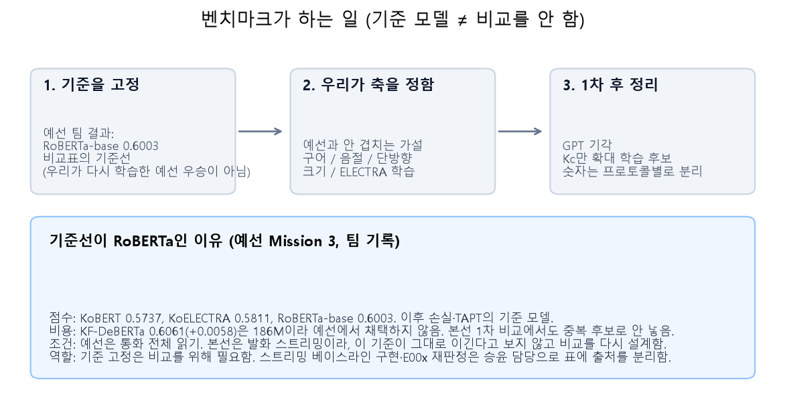
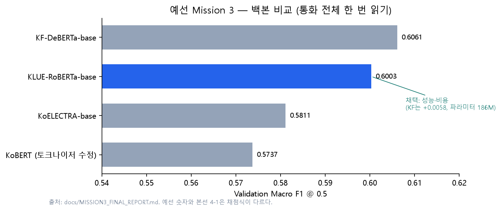
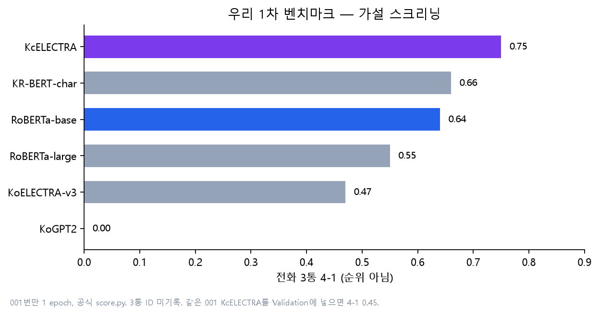
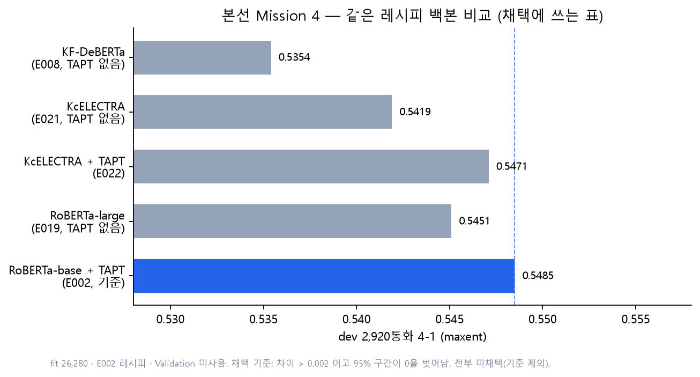
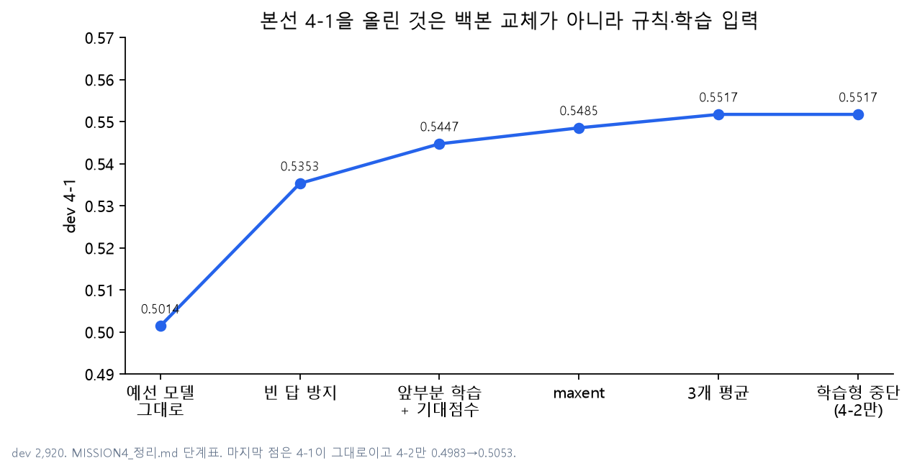

# Mission 4 백본 벤치마크 (비교·정리)

**이 문서의 역할:** 어떤 백본을 왜 비교했는지 정하고, 1차 결과를 모으고, 프로토콜이 다른 숫자는 섞지 않고 정리한다.  

## 한 줄

우리는 예선 RoBERTa를 **비교의 기준선**으로 두고, 본선 스트리밍에 맞는 가설로 백본을 다시 골랐다. 1차(001·전화 3통)에서 KoGPT2는 기각, KcELECTRA는 확대 후보였다. 그 3통과 Validation 0.69는 순위가 아니다. 제출 백본을 바꾼 근거로 쓰지 않는다.

## 역할

| | 담당 | 산출 |
|---|---|---|
| 비교 설계·1차 학습·표 정리 | 이쪽 (벤치마크) | 가설 표, `mission4-koelectra` 등 브랜치, 001/3통 점수, 이 문서 |
| 스트리밍 추론·dev 공정 재판정·제출  | `mission4-streaming`, E008·E019·E021·E022, `ckpt/mission4.pt` |

## 1. 왜 본선에서 백본을 다시 비교했는가

예선 Mission 3은 통화가 끝난 전사를 한 번에 읽는다. 본선 Mission 4는 발화가 하나씩 들어올 때마다 증상을 내고, 4-2는 언제 멈출지도 고른다. 전체 발화 수·통화 시간은 쓸 수 없다.

예선에서 팀이 고른 백본은 KLUE-RoBERTa-base다. 뉴스·위키 문어를 양방향으로 읽도록 미리 배운 모델이고, **통화 전체** 조건에서 Macro F1@0.5가 가장 쓰기 좋았다. 본선은 그 조건이 아니다. 데이터가 다른 말뭉치로 바뀌어서가 아니라, **앞부분만 보고 답을 내는 과제에서도 그 모델이 나은지**를 보려고 비교를 다시 열었다.

그래서 RoBERTa는 “이미 정한 제출 모델”이 아니라 **표의 기준 열**이다.

## 2. 기준선이 RoBERTa인 이유 (예선 Mission 3)

이 숫자는 예선 최종 보고서의 팀 기록이다. 본선 4-1과 채점식이 다르다.

| 모델 | Validation Macro F1@0.5 | 당시 팀 판정 |
|---|---:|---|
| KoBERT (토크나이저 수정) | 0.5737 | 미채택 |
| KoELECTRA-base | 0.5811 | 미채택 |
| KLUE-RoBERTa-base | **0.6003** (재현 0.5967) | **기준 백본** |
| KF-DeBERTa-base | 0.6061 | +0.0058, 186M → 비용으로 미채택 |

기준선으로 둔 이유 네 가지:

1. **점수.** 같은 임계 0.5에서 KoBERT·KoELECTRA보다 높다. 이후 pos_weight·TAPT도 이 모델 위에 쌓였다.
2. **비용.** KF가 조금 높지만 예선에서 이미 버렸다. 본선 1차 비교에 KF를 다시 넣지 않은 이유이기도 하다(승윤이 E008로 따로 봤다).
3. **과제 차이.** 예선 우승 ≠ 스트리밍 우승. 기준만 고정하고 본선용 후보를 새로 짠다.
4. **비교 설계.** 기준이 없으면 1차 표의 0.64가 “좋은지”를 말할 수 없다.

## 3. 우리가 고른 비교축 (예선 중복을 피함)

비교 대상은 모두 **그 시점까지 쌓인 전사를 읽고 증상 9개 확률을 내는 텍스트 분류기**다. 음성 모델이 아니다. 예선에서 이미 돌린 KoBERT·KF-DeBERTa는 1차 세트에서 뺐다.

### 각 모델이 무엇인가, 비교에서 맡은 역할

여섯 개를 나란히 넣은 이유는 “더 좋은 한국어 모델”을 찾기 위해서가 아니라, **RoBERTa와 한 가지만 다르게** 보기 위해서다.

**KLUE-RoBERTa-base** (`klue/roberta-base`)  
뉴스·위키 같은 문어를 양방향으로 읽고, 빈칸의 단어를 맞히도록 미리 배웠다. 파라미터는 약 110M. 예선 Mission 3에서 Macro F1@0.5 0.6003으로 팀이 고른 모델이다.  
**역할: 기준선.** 다른 다섯의 점수가 높은지 낮은지를 이 모델에 붙인다. 제출 후보를 미리 정한 것이 아니라, 표의 기준 열이다.

**KLUE-RoBERTa-large** (`klue/roberta-large`)  
구조·사전학습은 base와 같고 크기만 약 3배(약 330M, 24층)다.  
**역할: 용량.** 앞부분만 보고 애매한 복합 증상을 파라미터로 밀어 올릴 수 있는지 본다. 발화마다 반복 추론이라 느리면 본선에서 불리하다.

**KoELECTRA-v3** (`monologg/koelectra-base-v3`)  
크기는 base급이다. 빈칸을 맞히는 대신, 문장에 바꿔 끼운 가짜 단어를 찾아내는 ELECTRA(RTD) 방식으로 배웠다. 말뭉치는 RoBERTa와 비슷하게 문어 쪽이다. 예선에서는 0.5811로 RoBERTa보다 낮았다.  
**역할: 학습 방식.** 초반 비문·단편(“머리… 토”)에 토큰 단위로 더 민감한지 본다. 구어 말뭉치 효과와 섞지 않기 위해 KcELECTRA와 따로 둔다.

**KcELECTRA** (`beomi/KcELECTRA-base-v2022`)  
ELECTRA 방식은 KoELECTRA와 같고, 뉴스 댓글처럼 말하듯이 쓴 글 약 1.7억 문장으로 배웠다. 크기는 RoBERTa-base와 비슷하다.  
**역할: 구어 도메인.** 119 신고의 말더듬·축약·비표준 표현(“막 숨이 차가꼬요”)에 맞는지 본다. 1차에서 가장 커 보여 확대 학습 후보로만 넘겼다. 채택은 같은 조건 재판정 뒤에 한다.

**KR-BERT-char** (`snunlp/KR-BERT-char16424`)  
단어를 통째로 쪼개지 않고 음절·자모 단위로 읽는다.  
**역할: 형태.** 띄어쓰기·줄임말이 깨진 전사에서도 “숨쉬기 힘들고” 같은 조각이 남는지 본다.

**KoGPT2** (`skt/kogpt2-base-v2`)  
왼쪽에서 오른쪽으로만 읽는 생성 모델(약 125M)이다. 뒤에서 앞을 다시 보지 못한다.  
**역할: 방향.** 발화가 시간순으로 쌓이니 단방향이 맞는지를 보는 대조군이다. 증상 9개를 동시에 보려면 앞뒤 문맥이 필요한 경우가 많다.

예선에서 뺀 것: **KoBERT**는 토크나이저 문제로 시작이 0이었고 고쳐도 0.5737. **KF-DeBERTa**는 예선 +0.0058이지만 186M·비용으로 미채택. 본선 1차 세트에도 넣지 않았다.

브랜치: `mission4-koelectra`, `mission4-kcelectra`, `mission4-krbert`, `mission4-kogpt2`, `mission4-roberta-large`, `mission4-kcelectra-full`.

## 4. 1차 결과 (이 절이 본문)

학습: 001번 zip만, 1 epoch. 채점: 우리 `inference.py` → 공식 `score.py`. **전화 3통의 4-1.** 그 3통 ID는 기록에 없다. **순위로 쓰지 않는다.**

같은 001 KcELECTRA를 Validation 3,640에 넣으면 4-1은 **0.45**다. 3통 0.75가 유지된 것이 아니다.

| 백본 | 3통 4-1 | 1차에서 한 말 |
|---|---:|---|
| KoGPT2 | 0.00 | 단방향은 다중 증상 확률이 0.5를 못 넘김 → **기각** |
| KoELECTRA-v3 | 0.47 | 기준보다 낮음. ELECTRA 학습만으로는 안 됨 |
| RoBERTa-large | 0.55 | 크기만으로는 기준(0.64)을 못 이김. 추론도 느림 |
| RoBERTa-base | 0.64 | 1차 기준 |
| KR-BERT-char | 0.66 | 음절 가설은 열어 둠. 표본이 작아 채택 아님 |
| KcELECTRA | 0.75 | 구어 가설이 가장 그럴듯. **확대 학습 후보** |

**1차에서 확정한 것:** GPT는 안 쓴다. large는 1순위가 아니다. 구어 KcELECTRA만 데이터를 늘려 볼 가치가 있다.  
**1차에서 확정하지 않은 것:** 제출 백본을 Kc로 바꾼다.

## 5. 확대 학습 숫자 — 정리할 때 빼는 것

KcELECTRA를 Training 캐시 32,840통, 2 epoch, 화자 태그, prefix 3·5·8·12로 학습한 뒤 Validation에 넣은 값:

- 임계 0.5: 4-1 0.6870
- maxent: 4-1 0.6933, 4-2 0.6438

이 숫자는 **우리 확대 실험의 로그**이지만, 비교·제출 근거로 쓰지 않는다.

1. `mission4-kcelectra` 노트북은 라벨 폴더 탐색이 Validation 서울 구급을 학습에 넣었다.
2. 32,840 = Training 29,200 + Validation 3,640.
3. 4-1 0.69는 “끝까지 정답을 모든 순간에 쓰는” 상한(승윤 측정 0.646)보다도 높다.

학습 범위가 다른 점수를 기준 RoBERTa Validation 0.530과 빼면 벤치마크가 아니다. 가중치 `본선/KcELECTRA`는 제출에 안 넣는다.

## 6. 공정 재판정

1차에서 Kc가 커 보여서, **같은 레시피·같은 Training 안 dev 2,920**으로 다시 쟀다. 채택 기준은 결과 보기 전에 등록: 차이 > 0.002 이고 95% 구간이 0 밖.

이 표는 출처가 `origin/mission4` results.csv / E021·E022 분석이다. 우리 1차 표와 **한 축에 그리지 않는다.**

| ID | 백본 | 4-1 단독 maxent | 판정 |
|---|---|---|---:|---|
| E002 | RoBERTa-base + TAPT | 0.5485 | 제출 멤버 |
| E019 | RoBERTa-large | 0.5451 | 미채택 |
| E021 | KcELECTRA, TAPT 없음 | 0.5419 | 미채택 |
| E022 | KcELECTRA + TAPT | 0.5471 | 미채택 (기준과 같음) |
| E008 | KF-DeBERTa | 0.5354 | 미채택 |

정리: 1차는 “구어가 유망하다”까지. 같은 조건으로 다시 재면 TAPT 없는 Kc는 기준보다 낮고, TAPT를 맞추면 RoBERTa와 같다. 그래서 **제출 텍스트 백본은 기준선 RoBERTa를 유지**한다. 그 유지 결정은 1차 0.75가 아니라 이 게이트다.

## 7. 발표에서 말할 문장

1. 본선은 스트리밍이라 예선 RoBERTa를 기준선으로만 두고, 구어·음절·단방향·크기·ELECTRA 학습축으로 다시 비교했다.
2. 1차에서 단방향 GPT는 죽었고, 크기만 키운 large는 기준을 못 이겼고, 구어 KcELECTRA가 확대 후보였다.
3. 3통과 누수 Validation은 순위에 쓰지 않는다. 그건 비교를 정리하는 역할이다.
4. 같은 레시피 재판정에서 대체 백본은 기준을 넘지 못했다. 제출은 기준선을 유지한다.

